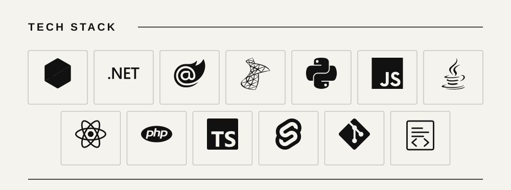
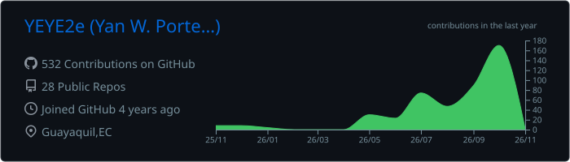
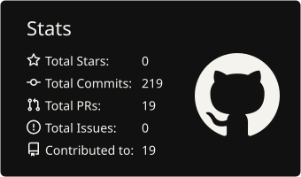
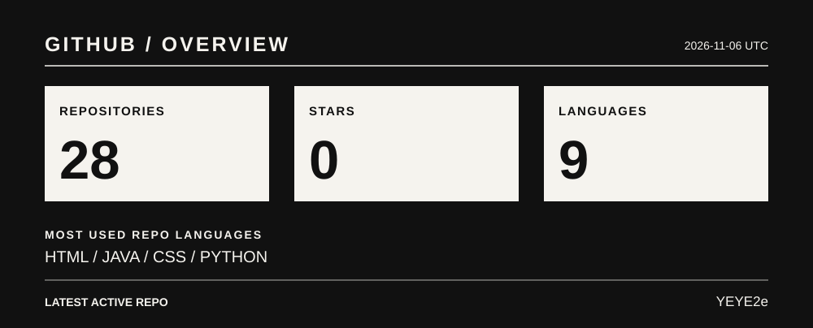

  

  Computer Engineering student focused on backend development, databases, and software architecture. 
  Guayaquil, Ecuador

  

  
  

  

  <a href="https://www.linkedin.com/in/yanporteroguzman">LinkedIn</a>
  &nbsp;·&nbsp;
  <a href="mailto:yanweiporteroguzman@gmail.com">Email</a>

