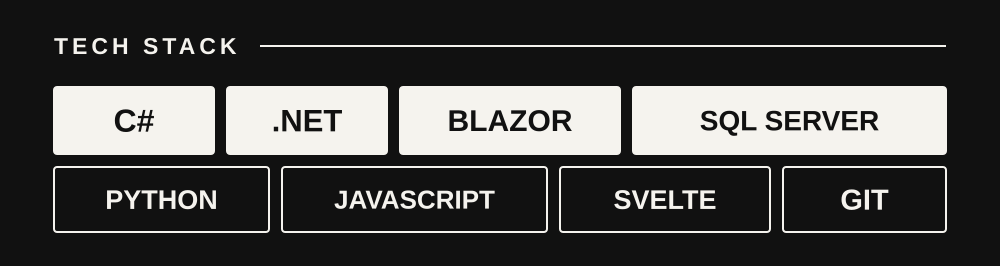

  

  Computer Engineering student · Guayaquil, Ecuador 
  Building reliable software, backend systems, and data-driven applications.

  

  <a href="https://www.linkedin.com/in/yanporteroguzman">LinkedIn</a>
  &nbsp;·&nbsp;
  <a href="mailto:yanweiporteroguzman@gmail.com">Email</a>

