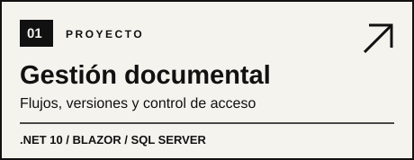
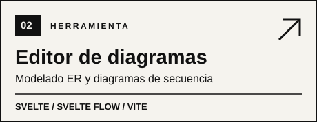

  

  <strong>Desarrollador de software · Backend &amp; arquitectura</strong> 
  Ingeniería en Computación · Guayaquil, Ecuador

  <a href="https://www.linkedin.com/in/yanporteroguzman">LinkedIn</a>
  &nbsp;·&nbsp;
  <a href="mailto:yanweiporteroguzman@gmail.com">Email</a>
  &nbsp;·&nbsp;
  <a href="https://github.com/YEYE2e?tab=repositories">Repositorios</a>

---

### Sobre mí

Diseño y desarrollo aplicaciones enfocadas en **backend, bases de datos y arquitectura de software**. Me interesa construir sistemas mantenibles, seguros y útiles para resolver problemas reales.

**Tecnologías:** `C#` · `.NET` · `Blazor` · `SQL Server` · `Python` · `JavaScript` · `Git`

### Proyectos destacados

  
  

  Menos ruido, más código.

